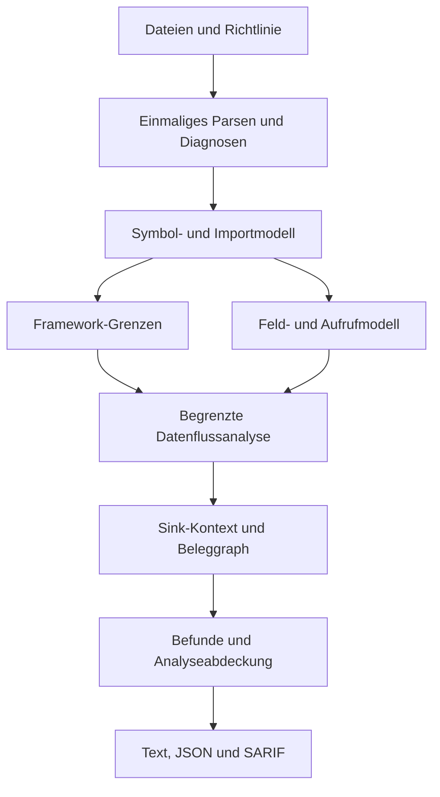

# LLMSafe: Technischer Wettbewerb und Umsetzung

**Technischer Entscheidungs- und Implementierungsplan | 23. Oktober 2026**

Repository: rezerpaul-crypto/llmsafe. Untersucht wurde main bei
c761627ad224a6f540d7ae6f06d2c076f426a6a6. Das Paket enthält Forschung,
reproduzierbare Prüffälle und einen Mac-Arbeitsauftrag. Die unten vorgeschlagenen
Scanner-Erweiterungen sind Entwicklungsarbeit für die nächsten Schritte.

## 1. Die technische Entscheidung

LLMSafe sollte seinen vorhandenen Python-Analyzer zuerst präziser machen:
Containerzustände korrekt verfolgen, echte Framework-Grenzen erkennen,
Prozessargumente nach ihrer Bedeutung unterscheiden und die Grenzen jeder Analyse
sichtbar ausweisen. Diese Kombination lässt sich durch nachvollziehbare Ergebnisse
belegen. Eine größere Regelzahl allein schafft keinen nachgewiesenen Vorsprung.

Die Recherche identifiziert sieben besonders relevante Vergleichsprojekte:
Agent Audit, Agentic Radar, Cisco MCP Scanner, Snyk Agent Scan, Promptfoo Code
Scanning, cruxet/mcp-audit und Semgrep. Akto und NVIDIA garak decken angrenzende
Schichten ab. Es handelt sich um eine internationale Projektauswahl anhand
technischer Ähnlichkeit; sie ist keine vollständige Weltmarktübersicht.

**Wichtig für die technische Position:** Offline-Scanning ist auch bei anderen
Projekten vorhanden. Agentic Radar dokumentiert einen lokalen statischen Kern,
cruxet/mcp-audit einen Offline-Konfigurationsscanner. Auch Datenflussanalyse ist
kein Alleinstellungsmerkmal. Der mögliche Vorteil von LLMSafe liegt in einem
kleinen, deterministischen, gut belegten Python-Agentenmodell mit geringer
Fehlalarmrate und überprüfbarer Analyseabdeckung. Dieser Vorteil ist ein
Entwicklungsziel und wurde gegenüber Wettbewerbern noch nicht gemessen. [S03-S10]

## 2. Der verifizierte Ausgangsstand

Die 127 Dateien des referenzierten Repository-Baums wurden anhand ihrer
Git-Blob-Hashes verifiziert. Die lokale Prüfmaschine ist Linux mit
Python 3.12.14; die Tests wurden hier nicht auf einem Mac ausgeführt.

| Bereich | Vorhandener Stand |
| --- | --- |
| Paket | Quellstand 0.3.0rc1; README nennt 0.2.1 als stabile Veröffentlichung |
| Sprachen | Strukturelle Analyse für Python und MCP-JSON; andere unterstützte Textdateien erhalten vor allem Secret-Prüfungen |
| Regeln | 23 stabile eingebaute IDs; fünf FLOW-Familien |
| Datenfluss | Lokale Funktionen, selektive Rückgabesummaries und begrenzte dateiübergreifende Aufrufe vorhanden |
| Vertrauensgrenzen | Benutzereingaben, Modellantworten sowie unterstützte offizielle OpenAI- und MCP-Tools |
| Ausgabe | Text, JSON v1 und SARIF 2.1.0; Baselines und Unterdrückungen vorhanden |
| Betrieb | Lokales statisches Lesen und Parsen; kein Import oder Start des Zielprojekts |
| Bestehende Prüfung | 158 Tests bestanden; 89,72 % Coverage bei bestehendem 85-%-Gate |
| Regression-Corpus | 21/21 Beispiele; 37/37 erwartete Regelsignale, keine unerwarteten Signale |
| Selbstscan | 106 ausgewählte Dateien, keine Findings und keine Scanfehler |
| Synthetische Leistung | 502 Dateien für 500 Module, 0,215337 s in einem Lauf; Budget 2 s |

Die Leistungszahl ist eine einzelne lokale Messung eines synthetischen
Aufrufketten-Corpus. Sie erlaubt keinen Geschwindigkeitsvergleich mit anderen
Produkten oder dem Mac. Die vorhandene Regression-Sammlung ist kein unabhängiger
Genauigkeitsbenchmark. [S01]

**Offener Arbeitsstand:** PR #44, „Reduce secret fixture false positives“, ist
am Recherchetag offen und nicht in main enthalten. Sein Head lautet
9041d7e1e9bc5312707ab3ced38e80a23f40c559. Die dort dokumentierten 162 Tests
gehören zu diesem PR und dürfen nicht als main-Ergebnis ausgegeben werden.
Vor späteren Änderungen den aktuellen PR-Status erneut lesen. [S02]

## 3. Die technisch ähnlichste Konkurrenz

Die folgenden Fähigkeiten sind aus den jeweiligen Primärquellen dokumentiert.
Wettbewerber wurden für diesen Bericht nicht installiert oder gegeneinander
ausgeführt. „Nicht belegt“ bedeutet fehlenden Nachweis in den untersuchten
Quellen, keine behauptete Abwesenheit einer Funktion.

| Projekt | Technische Nähe | Dokumentierte Stärke | Konsequenz für LLMSafe |
| --- | --- | --- | --- |
| Agent Audit | Sehr hoch: Python-Agenten, AST, Taint und MCP | Tool-Grenzen, Datenfluss, gestufte Secret-Filterung, Privileg- und Konfigurationsprüfungen | Quellen nach tatsächlicher Tool-Registrierung erkennen und sichere Gegenbeispiele ebenso ernst prüfen |
| Agentic Radar / SPLX | Sehr hoch: statische Analyse agentischer Workflows | Workflow-Graph, Tool-Inventar, MCP-Erkennung und HTML-Bericht; statischer Kern lokal, weitere Funktionen optional modellgestützt | Ein verständlicher Fähigkeiten- und Datenflussgraph sollte aus Analysebelegen entstehen |
| Cisco MCP Scanner | Hoch: MCP-Tools und Quellcode | Mehrere Analyseverfahren; zusätzlich LLM-gestützte Verhaltensprüfung mit dateiübergreifenden Flüssen und breiter Sprachabdeckung | Deterministische Python-Befunde und deklarative Fähigkeiten zuerst vertiefen; keinen kompletten Mehrsprachen-Nachbau beginnen |
| Snyk Agent Scan | Hoch bei MCP und Agent-Komponenten | Entdeckung installierter Komponenten, Tool-/Skill-Analyse mit lokalen Checks und Agent-Scan-API | Repository-Prüfung ohne Start von Servern und stabile Automationsverträge technisch sauber halten |
| Promptfoo Code Scanning | Hoch: LLM-spezifische Quellcodeprüfung | KI-Agenten verfolgen Codepfade über Dateien und prüfen Änderungen; Cloud standardmäßig, On-Prem separat | Lokale Reproduzierbarkeit und überprüfbare Spuren als messbare Alternative ausarbeiten |
| cruxet/mcp-audit | Hoch für den Konfigurationsanteil | Deterministische Offline-Prüfung von MCP-Clientkonfigurationen, inklusive riskanter Start-/Umgebungsparameter | MCP-Formate und Argumentsemantik ausbauen; einfache JSON-Suche reicht nicht |
| Semgrep CE / Semgrep Code | Hoch beim Analyseverfahren, breiterer Anwendungsbereich | CE bietet begrenztere Taint-Analyse; proprietäres Code-Produkt erweitert Funktions- und Dateigrenzen | Ein Vergleich muss Edition, Regeln und aktivierte Analyse explizit festhalten |
| Akto | Angrenzend: MCP-Discovery und Laufzeit-Governance | Sichtbarkeit von Verbindungen und Kontrolle laufender MCP-Interaktionen | Später standardisierte Befunde exportieren; zunächst den statischen Kern abschließen |
| NVIDIA garak | Angrenzend: Modell-/Systemverhalten | Tests und Red-Teaming gegen Modelle oder Systeme | Ergänzende Laufzeitvalidierung; kein direkter Ersatz für den Quellcode-Analyzer |

Quellen der Zeilen in gleicher Reihenfolge: [S03], [S04], [S05-S06], [S07],
[S08], [S09], [S10], [S11], [S12].

### Was sich daraus konkret ableiten lässt

Agent Audit ist besonders nah am eigentlichen LLMSafe-Kern. Die technische
Lehre ist die Bindung einer Quelle an einen real registrierten Tool-Einstieg,
ergänzt um sichere Gegenbeispiele. Regelzahlen und selbst veröffentlichte
Genauigkeitswerte aus unterschiedlichen Corpora sind kein fairer Vergleich. [S03]

Agentic Radar zeigt, wie hilfreich ein Workflow- und Tool-Inventar sein kann.
Ein LLMSafe-Bericht sollte deshalb pro Befund den tatsächlich beobachteten
Kontrollpfad visualisieren, statt nur gefährliche Funktionsnamen aufzulisten. [S04]

Cisco dokumentiert bereits einen Behavioral Analyzer mit LLM-gestütztem
Abgleich zwischen erklärtem Zweck und Implementierung. LLMSafe sollte daher
keine Überlegenheit bei semantischer Absichtserkennung behaupten. Eine sinnvolle
eigene Erweiterung wäre ein expliziter Vergleich zwischen deklarierter und
statisch beobachteter Fähigkeit, ohne daraus automatisch eine bewiesene
Exfiltration oder böswillige Absicht abzuleiten. [S06]

Bei Snyk gehören MCP-Erkennung und -Analyse zu einem anderen Betriebsmodell:
Für Tool-Metadaten können konfigurierte Server gestartet oder kontaktiert
werden; relevante Komponenteninformationen gehen an eine Analyse-API. Das rohe
CLI-Format wird ausdrücklich als experimentell bezeichnet. Das ergibt einen
konkreten Vergleichspunkt für LLMSafes vorhandene statische Betriebsgrenze und
versionierte Ausgabe, aber keinen pauschalen Qualitätsvorteil. [S07]

Promptfoo darf inzwischen nicht auf Red-Teaming reduziert werden: Das
Code-Scanning-Angebot ist ein direkter Wettbewerber. Seine dokumentierte
Agentenanalyse läuft standardmäßig in der Cloud; die Kommandozeile allein
bedeutet daher keinen ausschließlich lokalen Analysebetrieb. [S08]

## 4. Reproduzierte Grenzen des heutigen Codes

Die neue Sammlung enthält 18 gezielt ausgewählte Fälle. Acht gewünschte
Erwartungen werden auf dem Referenz-main erfüllt, zehn noch nicht. Die Auswahl
sucht bewusst nach Grenzen und ist deshalb keine Fehlerquote und kein
Wettbewerber-Ranking. Bewertet wird jeweils nur das angegebene FLOW-/MCP-Signal
oder eine Diagnose; weitere strukturelle Meldungen bleiben im Rohresultat sichtbar.

| Fall | Beobachtung auf Referenz-main | Gewünschtes Ziel |
| --- | --- | --- |
| B01 | Direkter Eingang nach eval erzeugt FLOW001 | Beibehalten |
| B02 | Lokaler dateiübergreifender Shell-Helper erzeugt FLOW002 | Beibehalten |
| B03 | Offizieller MCP-Toolparameter erzeugt FLOW001 | Beibehalten |
| B04 | Parametrisiertes SQL erzeugt kein FLOW003 | Beibehalten |
| B05 | Zusammengebautes SQL erzeugt FLOW003 | Beibehalten |
| G01 | LangChain-Toolparameter mit beliebigem Namen: PY001, aber keine FLOW001-Spur | Toolargument als kontrollierte Quelle modellieren |
| G02 | Pydantic tool_plain: PY001, aber keine FLOW001-Spur | Registrierten Parameter als Quelle modellieren |
| G03 | Instanzmethode: SHELL001 und irreführendes FLOW003, keine passende FLOW002-Spur | Methodenpfad auflösen und tatsächlichen Sink berichten |
| G04 | Festes /bin/echo mit Datenargument und shell=False erhält FLOW002 | Datenübergabe von Shell-/Interpreterkontrolle unterscheiden |
| G05 | Geschlossene Tabelle zweier harmloser Funktionen erhält FLOW005 | Bekannte Ziele analysieren statt Auswahl allein zu beanstanden |
| G06 | Syntaxfehler: keine Findings und keine Scanfehler | Nicht analysierbare Python-Datei sichtbar diagnostizieren |
| G07 | Dictionary-Feld wird beschrieben und später ausgewertet: keine FLOW001-Spur | Container-Mutationen korrekt verfolgen |
| G08 | Lokale harmlose execute-Methode erhält FLOW003 | Aufgelöste lokale Methode nicht als SQL-API behandeln |
| G09 | MCP command=/bin/bash mit -c wird nicht als MCP001 erkannt | Statische Pfadnormalisierung für Launcher ergänzen |
| G10 | MCP-JSON mit servers-Container wird nicht passend ausgewertet | Clientformate vor der Regelprüfung normalisieren |
| C01 | Injizierter LangChain-Laufzeitkontext erzeugt keine Modellargument-Spur | Beibehalten; Kontextinhalte können eigene Quellen besitzen |
| C02 | Injizierter Pydantic RunContext erzeugt keine Modellargument-Spur | Beibehalten; Herkunft seiner Daten getrennt verfolgen |
| C03 | Unabhängiges festes Dictionary-Feld erzeugt kein FLOW001 | Bei künftigem Feldmodell beibehalten |

G01/G02 bedeuten keine vollständig unsichtbare gefährliche API: PY001 wird
bereits ausgegeben. Die fehlende Information ist die passende Vertrauensgrenze
mit ihrer Datenflussspur. Ebenso meldet G03 bereits die Shell-API. Die Lücke
betrifft die Zuordnung der Eingabe zum richtigen Aufruf.

Die Entscheidung für G04/G05 präzisiert die gewünschte Semantik der FLOW-Regeln.
Sie fordert keinen allgemeinen Freibrief für feste Programme oder Tooltabellen:
Argument-Injection, Interpreter-Schalter und privilegierte registrierte Ziele
müssen weiter geprüft werden.

### Warum diese Fälle entstehen

- G07: _ScopeAnalyzer._assign behandelt Namen und Tupel/Listen-Ziele, aber
  keine schreibenden Subscript-/Attribute-Zugriffe. Im gemessenen Beispiel wird
  die erste Dictionary-Mutation bereits nicht erfasst; ein späteres sauberes
  Feld ist nicht als alleinige Ursache des Verlusts bewiesen.
- G04: _check_call_sink wertet taint im Prozessargument aus, ohne die Rolle des
  ausführbaren Programms, seiner Optionen und seiner Datenargumente ausreichend zu trennen.
- G03/G08: SQL-Sinks werden unter anderem am Suffix .execute/.executemany erkannt.
  Die Semantik einer bekannten lokalen Methode kann dadurch falsch zugeordnet werden.
- G01/G02: Bestimmte Tool-Grenzen sind konkret modelliert, die zusätzlichen
  LangChain-/Pydantic-Registrierungsformen noch nicht.
- G06: parse_python gibt bei SyntaxError/ValueError None zurück; diese
  Nichtanalyse wird derzeit nicht als Analyseproblem weitergereicht.
- G09/G10: MCPConfigRule vergleicht Launcher mit einfachen Namen und erwartet
  vor allem den mcpServers-Container beziehungsweise eine direkte Abbildung.

Fundstellen: llmsafe/rules/dataflow.py, llmsafe/rules/ast_helpers.py,
llmsafe/rules/mcp.py und llmsafe/scanner.py am referenzierten Commit. [S01]

## 5. Zielarchitektur innerhalb des vorhandenen Projekts

Die vorhandenen APIs, Regel-IDs und Formate bleiben Ausgangspunkt. Neue
Analysebausteine werden schrittweise herausgelöst; ein gleichzeitiger kompletter
Rewrite würde die Nachprüfbarkeit verschlechtern.



Vorgeschlagene interne Module unter llmsafe/analysis/: domain.py für abstrakte
Werte, symbols.py für Bindungen, locations.py für Felder, summaries.py für
Aufrufsummaries, diagnostics.py für Analysegrenzen und traces.py für Belege.
Framework-spezifische Adapter können unter llmsafe/adapters/ liegen.
DataflowRule bleibt zunächst die nach außen unveränderte Fassade.

### Abstrakter Zustand

Ein abstrakter Wert trägt mindestens Herkunftsmenge, bekannte Konstanten,
mögliche lokale Empfängertypen, belegte Einschränkungen und einen
Unknown-Status. Ein Speicherort besteht aus einer Symbol-ID und einem begrenzt
langen Feld-/Indexpfad. Das ist ein Implementierungsentwurf, kein neuer
öffentlicher Ausgabe-Vertrag.

Konstante Felder wie box["command"] und box["label"] bleiben getrennt.
Unbekannte Indizes erhalten ein Wildcard-Feld und werden konservativ mit
betroffenen Lesezugriffen verbunden. Ein eindeutiger Zielort erlaubt ein
starkes Update; bei mehreren möglichen Alias-Zielen wird vereinigt.
Neuzuweisung einer einfachen Variablen behält den vorhandenen Kill-Effekt.

Zunächst maximal drei Feldsegmente und begrenzte Konstantenmengen modellieren.
Bei Überschreitung zu einem konservativen Wert verbreitern und eine
Analysegrenze erfassen. Eine Grenze darf niemals still einen sauberen Wert erzeugen.

### Aufrufe und Unsicherheit

Importbindung, Namensüberschreibung und lokale Definitionen haben Vorrang vor
einem bloßen Funktionssuffix. Bekannte lokale Aufrufe verwenden ihre
Summaries; unbekannte Aufrufe bleiben als unbekannt erkennbar.
Unaufgelöste Methoden sind kein Beweis für Sicherheit.

Eine Modellquelle allein beweist auch keine ausnutzbare Prompt Injection.
Ein vollständiger Bericht trennt kontrollierte Quelle, gefährliche Fähigkeit,
belegte Übergänge und verbleibende Voraussetzungen.

## 6. Arbeitspakete mit konkreter Abnahme

Die Aufwände sind grobe volle Entwicklungstage eines erfahrenen Entwicklers,
keine Zusage für einen autonomen Einmallauf. Jeder Schritt erhält einen kleinen
PR und eine eigene geprüfte Revision. Die erste sinnvolle Etappe sind A-D
plus die sichtbaren Diagnose-/MCP-Korrekturen; Klassen- und Trace-Ausbau folgen
darauf. Vor Codeänderungen aktuelle konkurrierende PRs prüfen.

### Paket A - Container-Mutationen und Felder

**Priorität P0. Aufwand 2-4 Tage.**
Ausgangspunkt: _assign, _expression, Environment und FunctionSummary in
llmsafe/rules/dataflow.py. Neue interne Location-/Value-Typen zunächst klein
halten; bei größeren Änderungen in analysis/locations.py auslagern.

1. Schreib- und Lesezugriffe auf konstante Dictionary-Schlüssel verbinden.
2. Verschiedene Schlüssel getrennt halten; unbekannte Schlüssel konservativ vereinigen.
3. Alias-Mengen, Zweig-Merges und skalare Neuzuweisung definieren.
4. Feldwerte über vorhandene lokale Rückgabe-Summaries tragen; unbekannte
   Objektmutation als Unsicherheit erhalten.
5. Anschließend Attribute und bekannte einfache Containeroperationen erweitern.

**Abnahme:** G07 besteht; C03 bleibt sauber. Zusätzliche Tests für Aliase,
unbekannten Schlüssel, unterschiedliche Zweige, erneute Zuweisung und
dateiübergreifende Rückgabe bestehen. Bestehende 37 Regelsignale bleiben erhalten.
Kein neuer Parser, kein Zielcode-Import und kein Wechsel des JSON-Vertrags.

### Paket B - Kontext von Prozess- und Interpreteraufrufen

**Priorität P1. Aufwand 2-3 Tage.**
Ausgangspunkt: _check_call_sink, SUBPROCESS_CALLS und bestehende Shell-Regeln.

| Aufrufform | Gewünschte technische Behandlung |
| --- | --- |
| os.system mit kontrolliertem Text | Shellkontrolle melden |
| subprocess mit shell=True und kontrolliertem Befehl | Shell-Injection-Pfad melden |
| shell=False, kontrolliertes argv[0] oder executable | Kontrolle über das gestartete Programm melden |
| Feste Shell mit -c, Python mit -c oder vergleichbarer Interpreter-Eingabe | Kontrollierten Programmtext als Code-/Shell-Sink behandeln |
| Festes echo und ausschließlich Datenargument | Keine pauschale High-Meldung über Shell-Injection |
| Gefährliche Optionen eines festen Programms | Eigene dokumentierte Argument-Semantik prüfen |
| Dynamische Shell-Option, env oder cwd | Unsicherheit beziehungsweise eigene kontrollierte Einflussrolle erhalten |

Windows-Batchdateien und plattformspezifische Launcher getrennt prüfen.
shell=False allein ist kein genereller Sicherheitsbeweis. Für die Abgrenzung
ist die offizielle subprocess-Dokumentation die Grundlage. [S15]

**Abnahme:** G04 besteht. Neue Angriffsbeispiele für kontrolliertes Programm,
expliziten Interpreter und shell=True werden weiterhin erkannt. Nicht nur den
Parameter shell=False als globalen Sanitizer einführen. Verhalten und
Schweregradbedeutung von FLOW002 dokumentieren.

### Paket C - Geschlossene Tool-Auswahl

**Priorität P1. Aufwand 1-2 Tage.**
Ausgangspunkt: FLOW005, AST-Subscript-Aufrufe, lokale Funktionstabellen und Summaries.

Konstante Registry-Schlüssel und lokale Funktionswerte zusammenführen.
Bei bekannter Tabelle mögliche Ziele analysieren. Ist ein Ziel gefährlich,
dessen Quellen-/Argumentpfad melden; eine Wahl zwischen zwei harmlosen
Funktionen erzeugt keinen erfundenen kritischen Dispatch-Befund.
Mutation, unbekannte Funktionswerte und nachträgliche Erweiterung heben den
Nachweis einer geschlossenen Tabelle auf.

**Abnahme:** G05 besteht. Gegenfälle mit dynamischer Registry, hinzugefügtem
gefährlichem Ziel, unbekannten Schlüsseln und Modelltext als Codeziel bleiben sichtbar.
Eine Tabelle wird nicht allein wegen ihres Namens als vertrauenswürdig eingestuft.

### Paket D - Belastbare Framework-Adapter

**Priorität P1. Aufwand 2-3 Tage für die ersten zwei Adapter.**
Ausgangspunkt: _mcp_tool_functions, _openai_tool_functions,
_scope_import_context und parameter_environment. Vorhandene OpenAI-/MCP-Tests
als Muster verwenden, ohne ihre konkreten SDK-Typen zu vermischen.

LangChain: importiertes @tool, Alias und benannte Dekoratorform erkennen.
Modellsichtbare Parameter werden Quellen; ToolRuntime und andere belegte
Injection-Parameter sind keine Modellargumente. Ihre später gelesenen
state-/message-Daten können dennoch eigene untrusted Herkunft haben. [S13]

Pydantic AI: Agent-Instanz statisch auflösen; @agent.tool_plain und @agent.tool
sowie danach explizite Tool-Registrierung modellieren. RunContext als
injizierten Kontext behandeln. Eine Pydantic-Schemavalidierung ist kein
allgemeiner Sanitizer für Shell, SQL oder URLs. [S14]

**Abnahme:** G01/G02 bestehen; C01/C02 bleiben ohne erfundene
Modellargument-Quelle. Alias-, Rebinding-, gleichnamige Fremd-Dekorator-,
async- und Context-Negativfälle sind getestet. Jeder Adapter dokumentiert
seine getesteten API-Snapshots und bewusst nicht aufgelösten Formen.

### Paket E - Lokale Instanzmethoden und Empfängeridentität

**Priorität P1 nach A/D. Aufwand 3-5 Tage.**
Lokale Klassendefinitionen und eindeutige Instanziierungsstellen als
begrenzte Typmenge modellieren. self an Parameter-Summaries binden.
Zunächst direkte Methoden ohne dynamische Vererbung unterstützen.
Mehrdeutige Typen vereinigen; monkeypatching und dynamische Attribute
mit sichtbarer Begrenzung behandeln.

Eine aufgelöste lokale Recorder.execute-Methode darf nicht wegen .execute
zum SQL-Sink werden. Bei echten oder plausiblen DB-Aufrufen bleiben bisherige
SQL-Erkennungen erhalten, mit passend ausgewiesener Belegstärke.
Unbekannte Empfänger werden nicht still als ungefährlich behandelt.

**Abnahme:** G03 erhält FLOW002 mit passendem Belegpfad; G08 verliert das
irreführende FLOW003. B05 sowie vorhandene SQL-Regressionsfälle bleiben
erkannt. Tests für Alias einer Instanz, async-Methode, Zweigtypen, unbekannte
Klasse und überschriebene Bindung bestehen.

### Paket F - Analysegesundheit und Ausgabe-Verträge

**Priorität P1; kleiner Diagnose-Fix früh möglich. Aufwand 1-2 Tage,
größerer JSON-v2-Vertrag separat.**
Ein Parse-Ergebnis enthält AST oder Diagnose mit Dateiposition.
Scanner sammelt Fehler und begründete Auslassungen.
Syntaxfehler werden nicht als erfolgreicher vollständiger Python-Scan
beschrieben. Der Textbericht benennt die Nichtanalyse; CI kann sie blockieren.

Der bestehende JSON-v1-Schema hat additionalProperties=false.
Neue Felder wie diagnostics, confidence oder coverage dürfen deshalb
nicht ungefragt in v1 erscheinen. Syntaxfehler können als existierende
ScanError-Datensätze mit dem dokumentierten Exit-Code 2 transportiert werden;
die geänderte Behandlung bisher ignorierter Syntaxfehler benötigt
Migrationsnotiz und Kompatibilitätstests.

Ein später ausdrücklich gewähltes JSON v2 kann ergänzen:
parse_status, Auslassungsgründe, unterstützte Grenzen, unsichere Aufrufe,
Budgetüberschreitung, Belegstärke und Trace-Trunkierung.
Severity beschreibt Auswirkung, Belegstärke die Qualität des Nachweises.
Keine erfundene Prozentwahrscheinlichkeit an einen heuristischen Befund hängen.

**Abnahme:** G06 besteht. V1 bleibt formgerecht; Exit-Codes 0/1/2 behalten
ihre dokumentierte Bedeutung. Syntax-, Encoding-, Größen-, ausgeschlossene
Datei- und Rule-Failure-Fälle unterscheiden sich nachvollziehbar.
„Vollständig“ bezieht sich ausschließlich auf die erklärte unterstützte
Analysegrenze, nicht auf alle möglichen Python-Laufzeitpfade.

### Paket G - MCP-Konfigurationen normalisieren

**Priorität P1. Aufwand 1-2 Tage für den belegten Kern.**
Einen kleinen Normalisierungsschritt vor MCPConfigRule setzen:
Clientformat, Server-ID, Transport, Launcher, Argumente, Umgebungsreferenzen,
Grant-Einstellungen und Quellposition zusammenführen.

Unterstützte JSON-Container mcpServers und servers explizit unterscheiden.
VS Code dokumentiert beide Formate mit jeweils unterschiedlichem Kontext.
Feldnamen dürfen nicht ohne Formatwissen zwischen Clients umgedeutet werden. [S16]

Absolute POSIX- und Windows-Pfade lexikalisch behandeln, ohne Programme auf dem
Host zu suchen oder auszuführen. Ein absoluter Shell-Launcher mit bekanntem
Befehlsschalter bleibt ein Shell-Launcher. Remote-HTTP und Loopback weiterhin
unterscheiden; fehlende Auth-Felder sind kein Beweis für fehlende Authentisierung.

Danach JSONC oder weitere Clientformate nur mit passenden Parsern und Tests
hinzunehmen. Kommentare nicht mit einer groben Regex entfernen, die URLs oder
Strings beschädigt. Quellenpositionen pro Server via Parser-Spans/JSON-Pointer
halten, nicht stets die erste gleichlautende Zeichenfolge verwenden.

**Abnahme:** G09/G10 bestehen. Positive und negative Fälle für absolute
Launcher, feste direkte Programme, Loopback, mehrere Server, wiederholte Werte
und tatsächlich unterschiedliche Clientfelder bestehen. Der Scanner startet
keinen Server und lädt keine globalen Nutzerkonfigurationen ungefragt.

### Paket H - Vollständige Belege und Fähigkeitenansicht

**Priorität P2. Aufwand 2-3 Tage.**
Die derzeit begrenzte Menge von Quellen und Helper-Hinweisen zu einem
Provenienzgraphen ausbauen. Kanten enthalten Quelle, Zuweisung, Aufruf,
Rückgabe, Modellgrenze und Sink-Rolle. Für einen Befund einen deterministisch
gewählten nachvollziehbaren Pfad rekonstruieren.

JSON v2 kann den Graphausschnitt liefern; SARIF codeFlows bildet den geordneten
Pfad ab. Eine begrenzte Pfadlänge mit ausgewiesener Trunkierung hält große
Projekte beherrschbar. Relative Pfade, Unicode-Spalten und CRLF-Dateien testen.
Ein späteres lokales HTML kann Quelle, Zwischenmodule und Sink visualisieren.

Fähigkeiten wie process_execute, outbound_request, file_write und
dynamic_dispatch aus konkreten Aufrufen ableiten. Ein beobachteter Schreib-
oder Netzaufruf widerspricht eventuell einer deklarierten Read-only-Absicht,
beweist aber allein noch keine Exfiltration. Tool-Annotationen dürfen Befunde
nicht automatisch unterdrücken; die MCP-Spezifikation behandelt sie als
potenziell nicht vertrauenswürdig. [S17]

**Abnahme:** Drei Module mit mehreren Helpern ergeben einen geordneten,
reproduzierbaren Trace. Ein Zyklus terminiert. Zwei alternative Pfade bleiben
deterministisch. Metadaten können keine Codebelege überstimmen.

### Paket I - Fairer Vergleich und unabhängige Validierung

**Priorität P1 als Begleitaufgabe, Freigabe vor Überlegenheitsbehauptungen.
Aufwand 3-5 Tage plus externe Rückmeldung.**
Die 18 fokussierten Fälle bleiben Regressionstests.
Daneben einen eingefrorenen, separat bewerteten Corpus einrichten:
bekannte verwundbare/sichere Paare, echte öffentliche Projekte mit gepinntem
Commit und zurückgehaltene Varianten. Bestehendes
docs/real-world-benchmark-protocol.md weiterverwenden.

Für jeden Toollauf exakte Version, Edition, Konfiguration, Regelpaket,
Dateiauswahl, aktivierte Modellfunktionen, Netzwerkbedarf und Ressourcen
protokollieren. SAST mit SAST auf gleicher unterstützter Teilmenge vergleichen;
MCP-Laufzeitscanner und Modelltests separat ausweisen. Ein Tool, das das
Eingabeformat nicht unterstützt, ist nicht automatisch ein Fehlnegativ.

Pro Befund Quelle, Sink, Duplikat-Zuordnung, TP/FP/unklar und Begründung erfassen.
Für Recall braucht es bekannte verwundbare Fälle beziehungsweise eine
explizit definierte Ground Truth. Ein Selbstscan ohne Findings liefert keine
Aussage über Recall oder Präzision.

Vorgeschlagene spätere Entwicklungsziele: mindestens 95 % Präzision für
High-/Critical-Befunde auf mindestens 100 unabhängig bewerteten Befunden und
mindestens 90 % Recall auf einem vorab definierten, ausreichend besetzten
unterstützten Hochrisiko-Corpus. Stichprobenumfang, Konfidenzintervalle,
Anteil unklarer Fälle und Ergebnisse pro Regel-/Frameworkfamilie mitberichten.
Diese Werte sind Zielgrößen und keine heute gemessenen Produkteigenschaften.

**Abnahme:** Rohdaten, Versionen und Triage sind reproduzierbar; mindestens
ein externer Reproduktionslauf ergänzt die vorhandenen Release-Voraussetzungen.
Keine fremden privaten Quellen oder ungeprüften Vulnerability-Behauptungen veröffentlichen.

### Paket J - Inkrementelle Analyse erst nach korrekter Semantik

**Priorität P2. Aufwand 2-4 Tage.**
Zunächst pro Scan nur einmal parsen. Danach lokale Summaries nach
Inhaltshash, Analyzer-/Adapterversion, Python-Parser und relevanter Richtlinie
cachen. Eine Änderung invalidiert die abhängigen Caller/Importer einschließlich
Zyklen. Regeln, Imports, Re-Exports, Ausschlüsse und Scanneränderungen
gehören zur Invalidierungslogik.

Keine pickle-Dateien aus fremden Projektordnern laden. Ein lokaler Cache
mit validiertem versioniertem Datenformat ist ausreichend.
Der vollständige Scan bleibt die Referenz für Ergebnisgleichheit.

**Abnahme:** Voll- und inkrementeller Lauf liefern dieselben Befunde und
Diagnosen, auch nach geänderter Importbindung oder Richtlinie.
Auf dem Mac zehn dokumentierte Läufe messen, Median und Maximum angeben.
Das bisherige 500-Modul-Budget bleibt erhalten; zusätzliche Praxis-Corpora
werden separat mit Zeit- und Speicherbedarf ausgewiesen.

## 7. Sanitizer: bewusst erst mit belegtem Kontext

Ein Funktionsname wie sanitize, validate oder escape löscht keinen Taint.
Auch ein gültiger String oder ein JSON-Schema beweist keine sichere Verwendung.
Für eine Einschränkung muss der Analyzer sehen, welche Eigenschaft geprüft wird,
welcher Wert anschließend den Sink erreicht und ob die Prüfung diesen Pfad
tatsächlich beherrscht.

Beispiele: SQL-Parameter werden in der Datenposition gebunden; eine feste
Programmliste erlaubt ein bestimmtes argv[0]; eine URL-Freigabe muss relevante
URL-Bestandteile und gegebenenfalls Weiterleitungen berücksichtigen.
Solche Nachweise sind unterschiedlich und nicht gegeneinander austauschbar.
Nicht modellierte DNS-, Dateisystem- oder Autorisierungszustände bleiben
ausdrücklich außerhalb des statischen Beweises.

Erst nach A-E sind kontrollierte, sinkspezifische Constraint-Modelle sinnvoll.
Ein vorzeitiger globaler Sanitizer würde Fehlalarme senken, könnte aber echte
gefährliche Flüsse unsichtbar machen.

## 8. Reihenfolge und Stop-Kriterien

| Etappe | Pakete | Ergebnis |
| --- | --- | --- |
| Sofort | Aktuellen Stand und PR #44 prüfen; Harness auf Mac ausführen | Reproduzierbare Arbeitsgrundlage, lokale Änderungen erhalten |
| Erste Implementierung | A, danach B/C | Containerlücke schließen und Prozess-/Dispatch-Semantik präzisieren |
| Agentenabdeckung | D, dann E | Framework-Grenzen und lokale Methoden zuverlässig verbinden |
| Früh begleitend | Kleiner F-Fix und G | Nichtanalyse und reale MCP-Konfigurationsgrenzen sichtbar machen |
| Prüfbarkeit | H und I | Belege erklären und Verbesserungen unabhängig bewerten |
| Skalierung | J | Bestehende korrekte Ergebnisse schneller wiederverwenden |

A-J zusammen entsprechen grob 19-33 vollen Entwicklungstagen zuzüglich
externer Rückmeldung. Der tatsächliche Aufwand hängt vor allem von
Alias-/Methodensemantik und kompatibler Ausgabe ab. Ein Mac-Agentenlauf sollte
jeweils ein abgegrenztes Paket fertigstellen, nicht alle Pakete ungeprüft bündeln.

Ein Paket stoppt vor Erweiterung des Umfangs, wenn eine Kontrollprobe kippt,
ein bisher erwartetes Signal unbeabsichtigt verschwindet, die Coverage-Grenze
unterschritten wird, ein Formatvertrag bricht oder Analysegrenzen still
als sicher behandelt werden. Dann Ursache korrigieren und nur die nötigen
Prüfungen erneut ausführen.

## 9. Was vorerst keine technische Priorität hat

Ein vollständiger Runtime-Proxy, ein generischer KI-Reviewer, eine eigene
Vulnerability-Datenbank und sofortige Mehrsprachen-Parität würden den
Wartungsumfang stark erhöhen. Die aktuellen reproduzierten Python-Grenzen
rechtfertigen zuerst die oben genannten Korrekturen.

TypeScript/JavaScript ist als spätere Erweiterung sinnvoll, sobald Python-
Semantik und Corpus belastbar sind. Dann kann ein zweites strukturelles
Frontend die gemeinsame Beleg-/Policy-Schicht verwenden. Heute erhalten diese
Dateien noch keine mit Python gleichwertige Datenflussanalyse.
Ein zweites Frontend darf daher nicht als kleiner Regex-Nachtrag versprochen werden.

## 10. Auf dem Mac konkret starten

Die genaue sichere Übernahme und der erste vollständige Implementierungsauftrag
stehen in MAC_CODEX_HANDOFF.md. Der Startbefehl im vorbereiteten Arbeitsordner lautet:

```bash
bash scripts/mac-research-check.sh
```

Zur Übernahme in einen neuen Arbeitsordner diese Befehle im vorhandenen
LLMSafe-Clone ausführen. Bereits vorhandene lokale Änderungen bleiben dort stehen:

```bash
git fetch origin research/technical-competition-2026-10-23
git worktree add -b review/llmsafe-plan-20261023 \
  ../llmsafe-technical-plan \
  origin/research/technical-competition-2026-10-23
cd ../llmsafe-technical-plan
bash scripts/mac-research-check.sh
```

Git und Python 3.12-3.14 müssen vorhanden sein. Der erste Lauf installiert nur
die bestehenden Entwicklungsabhängigkeiten in die lokale .venv. Für spätere
Läufe steht --check-only bereit. Ein bereits vorhandener Worktree-/Branchname
muss wiederverwendet oder durch einen freien Namen ersetzt werden.

Der Lauf prüft den vorhandenen Checkout mit dem etablierten Projekt-Workflow,
reproduziert die 18 Fokusfälle und misst den vorhandenen Performance-Corpus.
Er implementiert die Pakete A-J nicht automatisch.
Danach kann der beigefügte konkrete Auftrag an das Mac-Setup gegeben werden.

Der normale Entdeckungsmodus beendet sich erfolgreich, wenn die Reproduktion
funktioniert; bekannte GAPs werden angezeigt. --strict am Python-Harness
erzwingt die zukünftigen Akzeptanzerwartungen und schlägt auf dem Referenzstand
erwartungsgemäß fehl. Dieser separate Exit-Vertrag verändert die
LLMSafe-CLI nicht.

## 11. Quellen und Nachweisgrenze

Alle Quellen wurden am 23.10.2026 über ursprüngliche Projektrepositories oder
offizielle Dokumentationen geprüft. Die Zahlen zum eigenen Scanner stammen
aus dem verifizierten Quellstand und lokalen Läufen. Angaben zu Wettbewerbern
sind dokumentierte Fähigkeiten, keine unabhängigen Messungen.

Die technischen Verbesserungen und Zielschwellen sind aus diesen Beobachtungen
abgeleitete Entwürfe. Der Bericht behauptet weder einen heutigen weltweiten
Technologievorsprung noch eine garantierte Erkennung von Prompt Injection.

- **S01** LLMSafe README, Architektur und Quellcode: https://github.com/rezerpaul-crypto/llmsafe/tree/c761627ad224a6f540d7ae6f06d2c076f426a6a6
- **S02** LLMSafe PR #44: https://github.com/rezerpaul-crypto/llmsafe/pull/44
- **S03** Agent Audit: https://github.com/HeadyZhang/agent-audit
- **S04** Agentic Radar: https://github.com/splx-ai/agentic-radar
- **S05** Cisco MCP Scanner: https://github.com/cisco-ai-defense/mcp-scanner
- **S06** Cisco Behavioral Scanning: https://github.com/cisco-ai-defense/mcp-scanner/blob/main/docs/behavioral-scanning.md
- **S07** Snyk Agent Scan: https://raw.githubusercontent.com/snyk/agent-scan/main/README.md
- **S08** Promptfoo Code Scanning: https://www.promptfoo.dev/docs/code-scanning/
- **S09** cruxet/mcp-audit: https://github.com/cruxet/mcp-audit
- **S10** Semgrep CE und AppSec Platform: https://docs.semgrep.dev/semgrep-pro-vs-oss
- **S11** Akto MCP Security: https://www.akto.io/mcp-security
- **S12** NVIDIA garak: https://garak.ai/
- **S13** LangChain Tool-Dokumentation: https://docs.langchain.com/oss/python/langchain/tools
- **S14** Pydantic AI Function Tools: https://pydantic.dev/docs/ai/tools-toolsets/tools/
- **S15** Python subprocess: https://docs.python.org/3/library/subprocess.html
- **S16** VS Code MCP-Konfigurationsreferenz: https://code.visualstudio.com/docs/agents/reference/mcp-configuration
- **S17** MCP-Spezifikation Tools 2025-06-18: https://modelcontextprotocol.io/specification/2025-06-18/server/tools
